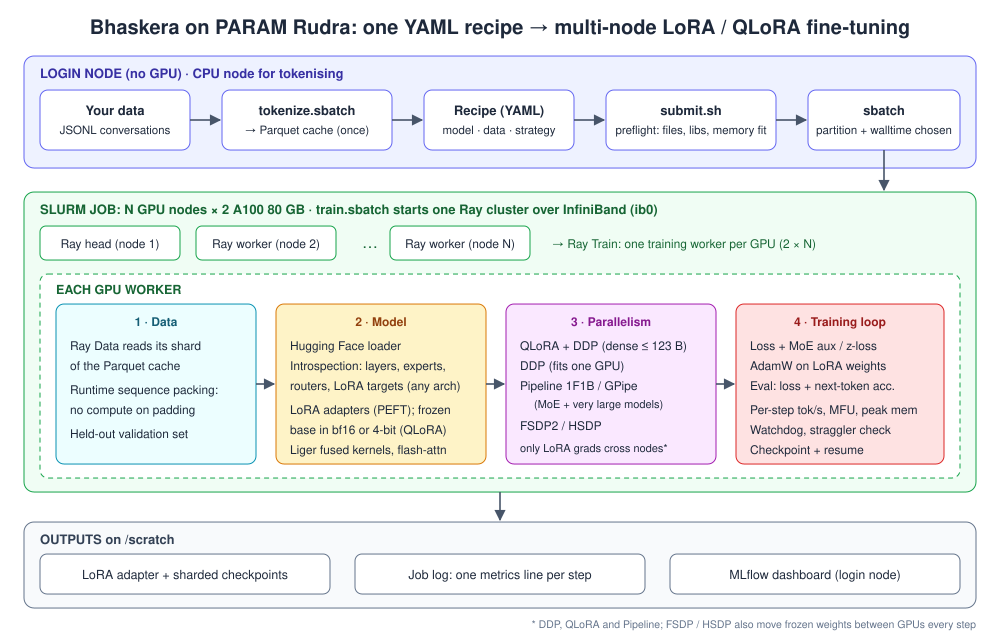

# Why Bhaskera

## Introduction

Fine-tuning a large language model on many GPU nodes usually means writing your own launch scripts,
choosing a parallelism strategy by trial and error, and finding out about memory limits after the job
has waited in the queue. Bhaskera packages all of that for PARAM Rudra: you pick a recipe, give it your
data and a node count, and it runs. Every recipe in this guide has been run on PARAM Rudra, and the
numbers below come from those runs.

## What You Get

- **Speed that scales with the number of nodes.** QLoRA recipes keep 34–39% MFU from 8 to 128 nodes, and
  Pipeline recipes 23–31% on dense models. Going from 8 to 128 nodes makes Qwen3-14B about 15 times faster
  (12.5 h to 49 min per epoch).
- **Large models on 80 GB GPUs.** QLoRA stores the frozen model in 4 bits: Llama-3.3-70B needs 55 GB per GPU
  instead of 141 GB, and Mistral-Large-123B fits as well. Pipeline trains Qwen3-235B at 45 GB per GPU.
- **A check before the job is queued.** `submit.sh` runs a preflight on the login node in seconds. It checks
  the model files, libraries and data, and estimates GPU memory to about 15% of the measured peak, so a job
  that cannot fit is rejected before it waits in the queue.
- **One file per run.** A recipe holds the model, the data and the strategy. Recipes for eight model and
  strategy combinations are included; change two paths and submit.

## Measured Benefits

### What each optimisation saves

Each optimisation was switched off on its own for the same run: **Qwen3-14B, QLoRA, 5 nodes (10 GPUs),
sequence length 4096, 10 steps**. Only one setting differs between rows.

| Run | Step time | MFU | Peak GPU memory | Real tokens / s | Compared with the full setup |
|---|---|---|---|---|---|
| **All on** (recipe as shipped) | 4.78 s | 35.4% | **16.0 GB** | **17,156** | |
| Triton kernels (Liger) **off** | 5.27 s | 32.1% | **29.9 GB** | 15,551 | **10% slower, +13.9 GB (1.9× the memory)** |
| Sequence packing **off** | 4.73 s | 35.8%\* | 16.0 GB | 9,826 | **1.75× slower** (42.5% of every batch is padding) |
| Flash-attention **off** (PyTorch attention, no packing) | 5.96 s | 28.4% | 16.2 GB | 8,176 | **2.1× slower** in total |

\* MFU counts padding as work, so it does not drop when packing is switched off; the real tokens per
second do.

### What that means for a full epoch

For a 1.24-billion-token dataset, scaling the measured Qwen3-14B QLoRA times (12.5 h on 8 nodes, 49 min
on 128 nodes) by the ratios above:

| Setup | 8 nodes | 128 nodes |
|---|---|---|
| All on | **12.5 h** | **49 min** |
| Triton kernels off | 13.8 h (+1.3 h) | 54 min |
| Packing off | 21.8 h (+9.3 h) | 1 h 26 min |
| Flash-attention and packing off | 26.2 h (+13.7 h) | 1 h 43 min |

### What each one does

| Optimisation | What it does | What it saves |
|---|---|---|
| **Triton kernels (Liger)** | Normalisation, rotary embedding, SwiGLU and the loss run as fused GPU kernels written in Triton. The loss is computed in chunks, so the full table of scores over the whole vocabulary (151,936 words for each of the 8,192 tokens one GPU handles per step) is never stored. | **46% less GPU memory** (29.9 → 16.0 GB) and **10% faster** steps. The memory saving is what leaves room for a larger batch or a longer sequence. |
| **Sequence packing** | Short conversations are joined into full 4096-token rows. | **1.75× more real tokens per second**: on this dataset 42.5% of an unpacked batch is padding. |
| **Flash-attention 2** | Computes attention in small tiles in fast on-chip memory (a CUDA kernel, not Triton). | **1.26× faster** steps (5.96 s vs 4.73 s, both without packing). It is also what makes packing possible. Memory is about the same here, because PyTorch's own attention already avoids the large attention table. |
| **QLoRA** | Stores the frozen model in 4 bits. | Qwen3-14B: **32 → 16 GB per GPU** and **31.6% → 35.5% MFU** (8 nodes). Llama-3.3-70B: the bf16 weights alone are 141 GB and cannot fit on an 80 GB GPU; with QLoRA the measured peak is **55 GB**. |

### Other measured effects

| What Bhaskera does | Effect, measured | Why |
|---|---|---|
| **Choosing the right strategy** | Qwen3-30B-A3B (MoE), 128 nodes: **33.4 h with FSDP → 53 min with Pipeline (38× faster)** | FSDP moves model weights between nodes every step; Pipeline and QLoRA move only small adapter updates |
| **Fast MoE experts (Pipeline)** | Qwen3-30B-A3B: **71.3 → 37.3 s per step (1.9×)**; Qwen3-235B: **88.3 → 47.0 s (1.9×)** | Frozen experts are computed as a few large matrix multiplications instead of one small one per expert |
| **Linear scaling** | Qwen3-14B QLoRA: **27,463 → 424,899 tokens/s** from 8 to 128 nodes (**15.5×** for 16× the nodes) | With LoRA, nodes exchange only adapter gradients |

!!! note "How these were measured"
    The four runs above are single 10-step runs on the same dataset, so treat differences of a few percent
    as noise. The size of each effect depends on the model: the Triton-kernel memory saving, for
    example, grows with the vocabulary size and the batch.

## How It Is Built

Bhaskera is a Python package built on PyTorch, Hugging Face Transformers and PEFT, with Ray for
starting and coordinating the processes across nodes.

| Layer | What it does |
|---|---|
| **Job scripts** | `submit.sh` checks the recipe and picks the partition; `train.sbatch` starts one Ray cluster across the job's nodes over InfiniBand |
| **Data** | Text is tokenised once into a Parquet cache; each GPU reads its own share, and sequences are packed on the fly |
| **Model** | Any Hugging Face causal language model; Bhaskera inspects it to find its layers, experts, routers and LoRA targets, so no model-specific code is needed |
| **Parallelism** | QLoRA + DDP, DDP, Pipeline (1F1B / GPipe), FSDP2 and HSDP, chosen with one line in the recipe |
| **Training loop** | LoRA training with evaluation (loss and next-token accuracy), MoE load-balancing losses, checkpoints, and one metrics line per step |

## Who It Is For

- **Researchers and students** who want to adapt an open model (Qwen, Llama, Mistral, BharatGen Param)
  to their own data without writing distributed-training code.
- **Teams with large models**: 70 B–235 B models on 8–128 nodes, with tables showing how long each
  takes before you submit.
- **Anyone new to PARAM Rudra**: the job scripts handle Ray, NCCL, InfiniBand and partition limits.

Start with [Installation](installation.md) and the [End-to-end Example](workflow.md).
